# 🧵 Loomis - the UI Weaver

> Turn your design notes into a clickable prototype - connected screens, all offline - before you build the real frontend.

**v0.2.0 - public preview.** It works, and it's tested (142 passing tests). Not many people have used it yet, so the CLI and the JSON output may still change before 1.0.

Loomis takes three markdown files - `DESIGN.md` (your colors, fonts, tone), `EXPERIENCE.md` (your screens and how they link), and your user stories - and builds a working set of HTML screens from them. It generates each screen with [Google Stitch](https://stitch.withgoogle.com/) over MCP, then wires them together into a site you can open and click through.

Everything it builds runs offline. Loomis pulls every asset - CSS, fonts, images - into the bundle, so `out/index.html` opens with your network off. (The studio's own UI uses web fonts; the prototype never does.)

It makes prototypes, not production code. The point is to hand you something connected to react to, fast.

## See it in action

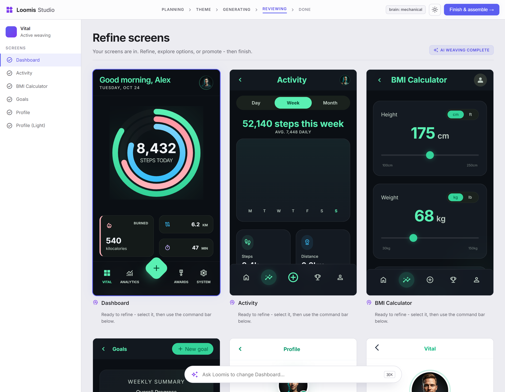

The studio runs the whole weave on a local page in your browser. You pick the theme, watch each screen come in, and change any of them in plain English. Reopen it later and your work is right there.

## Why I built this

I'm a programmer, and AI tools like Claude and Copilot are part of how I build. I've used them on my own projects to put together backends, an engine, frontends, and the backend side always came together - but the frontend kept letting me down. The screens I got back weren't connected to each other, and they weren't really what I had in my head.

A developer normally starts UI work from a Figma design, and I didn't have one. Around the same time I came across Stitch, and I'd only just learned MCP, so the idea clicked: what if I put those two together and got one connected prototype straight out of my own design notes, before writing any frontend?

That's how Loomis started, for myself first. If AI is part of how you build the way it is for me, I think you'll get it: you can bridge your design idea and the UI and actually hold a prototype before you commit to building the real thing.

## Quickstart

```bash
cd loomis
npm install
npm run build

# Set your Stitch key. Only the Stitch adapter reads it - nothing logs it, nothing ships it.
export STITCH_API_KEY=...        # PowerShell: $env:STITCH_API_KEY = "..."

# Weave an example. This opens the studio in your browser.
node dist/index.js studio ./run-vital ./examples/vital
```

Want to see the flow with no key and no network? Add `--fake`. The screens are stubs, but the whole process runs:

```bash
node dist/index.js studio ./run-vital ./examples/vital --fake
```

## The studio

The studio is the main way to use Loomis. It's a local web page that runs the weave and stops where you need to decide something.

You get:

- A live build. Pick the theme, then watch each screen arrive.
- Resume. Reopen a project and your screens are right there - no rebuild. One studio per project.
- A command bar that reads what you ask. Type *"make the header lighter"* and it edits that screen. Type *"show me a few options"* and it gives you alternatives to pick from. Type *"add a light-mode profile screen"* and it adds one next to the original. It never quietly replaces a screen when you asked for a new one.
- Live previews of every screen, and a theme that follows your system's light or dark setting.

Everything here also runs from the command line, for scripts or CI.

## What it builds

Real prototypes woven from specs, each one connected, clickable, and offline. Every screen below came out of a `DESIGN.md`, an `EXPERIENCE.md`, and a few stories.

**ShopKart** - a full e-commerce marketplace: search, a category strip, deal grids, and a product page with offers and buy actions.

<p>
  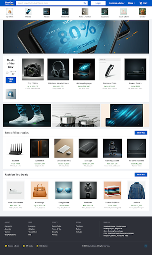
</p>

**Vital** - a health monitor.

<p>
  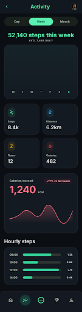
  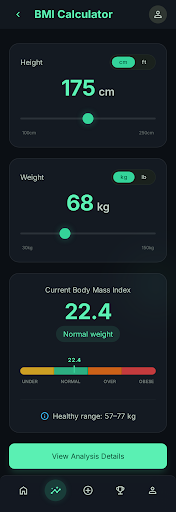
  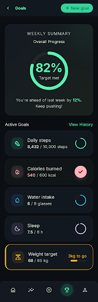
</p>

**Sigma** - a scientific calculator.

<p>
  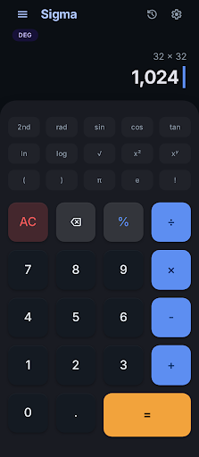
  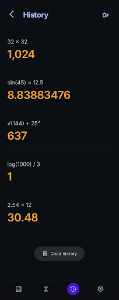
  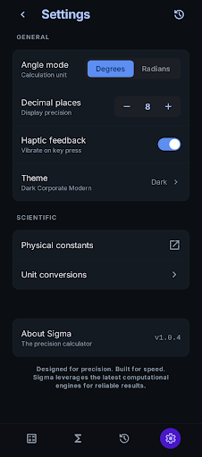
</p>

**Cadence** - a task app.

<p>
  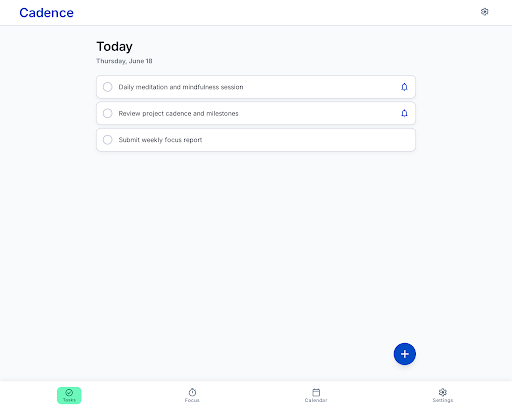
  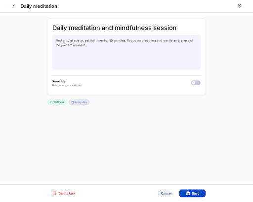
  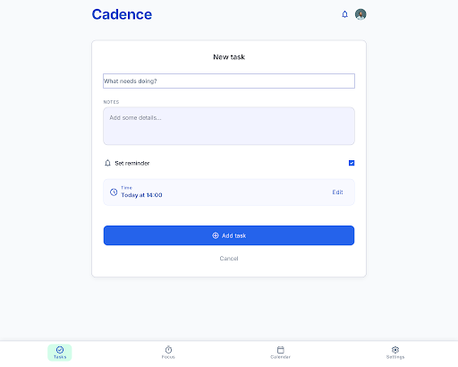
</p>

ShopKart, Vital, and Sigma ship as ready-to-weave inputs in [`examples/`](examples). Add `--fake` to walk the flow with no key.

## Two ways to use it

### Standalone - the supported path for 0.2.0

Clone, build, set your key, then run the studio or the CLI:

```bash
node dist/index.js studio ./run ./examples/vital
```

Your input is any folder with `DESIGN.md`, `EXPERIENCE.md`, and a `stories/` folder. Write them yourself, or use what BMAD's `bmad-ux` produces. This path needs no BMAD setup.

### As a BMAD module - installer coming in 0.2.x

Loomis ships the BMAD pieces as files: a persona (`bmad-agent-ui-weaver/`, the 🧵 UI Weaver) and a workflow (`bmad-weave-ui/`) that runs the same core. You can't drop it in yet. Wiring it into a BMAD project is manual today - copy the two skill folders into `.claude/skills/`, register the persona in `_bmad/custom/config.toml`, and point it at the built core. A one-command installer that does all of that is the next thing I'm building. The workflow itself is written up in [`bmad-weave-ui/SKILL.md`](./bmad-weave-ui/SKILL.md).

## How it works

```
DESIGN.md ─┐
EXPERIENCE.md ─┼─▶ sync (pin the design system) ─▶ list screens ─▶ generate each one
stories ─┘                                                            │
                                                                      ▼
        offline bundle  ◀── assemble + vendor ◀── wire the links ◀── build the page-graph
```

- Your `DESIGN.md` and `EXPERIENCE.md` drive everything. Loomis adds no UI of its own.
- One provider sits behind a port (`src/provider/uiprovider.ts`). Stitch is the real adapter; a fake in-memory adapter backs the tests and `--fake`.
- The run folder's `manifest.json` is the one file the agent and the core share. Every command prints one JSON line to stdout; logs go to stderr.
- A re-run skips screens that haven't changed, and every edit keeps the previous version.

## Verbs

| Verb | What it does |
|------|--------------|
| `init` / `validate` | create or check a run-folder manifest |
| `discover <input-dir>` | find `DESIGN.md` / `EXPERIENCE.md` / stories |
| `sync <run> <input>` | pin the design system from `DESIGN.md` |
| `design-gate` / `design-approve` | show the resolved theme, then record your approval |
| `enumerate` / `nav-graph` | list the screens, build the page-graph |
| `generate-all <run> <input>` | generate every screen |
| `wire` / `assemble` / `board` / `check` | link the screens, bundle offline, write the review board, check for dead links |
| `regen` / `variant` | re-roll a screen from the same spec |
| `refine <run> <screen> "…"` | edit one screen the way you asked, and record it |
| `refinements` / `reconcile` | list edits not yet in the spec, then fold them back into `EXPERIENCE.md` |
| `suggest` / `promote` | generate alternatives, then promote your pick |
| `add <run> <input> <base> "…"` | add a new screen based on an existing one |
| `coverage` | report which stories map to which screens |
| `watch` | a read-only live progress board |
| `studio` | the interactive weave (above) |

Add `--fake` to any generating verb to run against the in-memory provider, with no network.

## Configuration

| Variable | Purpose |
|----------|---------|
| `STITCH_API_KEY` | Your Stitch credential. Only the Stitch adapter reads it. It is never logged, never written to a file, and never shipped inside the prototype. See [`.env.example`](./.env.example). |

You need Node 22 or newer. I built and tested this on Windows; the CLI and studio run on macOS and Linux too (the studio opens your default browser on each).

## Develop

```bash
npm install
npm test            # vitest - 142 tests
npm run build       # tsup → dist/index.js
npx tsc --noEmit    # typecheck
```

See [`CONTRIBUTING.md`](./CONTRIBUTING.md) for the full loop, and [`docs/architecture.md`](./docs/architecture.md) for how it's put together.

## License

[MIT](./LICENSE) © Ragav
